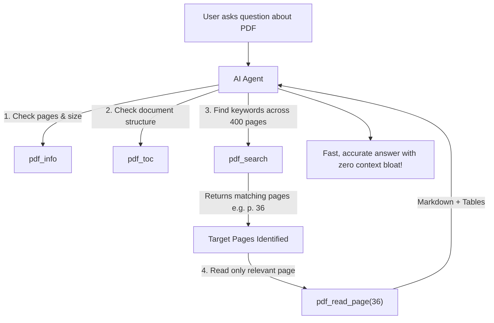

# ⚡ PDF Reader MCP Server

> **High-performance, ultra-low-token Model Context Protocol (MCP) server for LLMs and AI coding assistants.**  
> Powered by C-accelerated [PyMuPDF](https://github.com/pymupdf/PyMuPDF) and [pymupdf4llm](https://github.com/pymupdf/pymupdf4llm) for pristine Markdown and table extraction.

---

## 🎯 Why This MCP Server?

When AI agents (Claude, Gemini, Cursor, Antigravity) process PDFs through native chat uploads, the interface typically converts every page into high-resolution images (Vision) and raw OCR text:
* ⚠️ **Massive Token Waste**: A 13-page technical document consumes **30,000–50,000 tokens**. A 370-page service manual easily exceeds **1,000,000+ tokens**, blowing past context limits.
* ⚠️ **High Latency**: Uploading and parsing takes 15–40 seconds per interaction.
* ⚠️ **Loss of Formatting**: Tables and multi-column layouts frequently lose their structure in raw text extraction.

### The Solution: On-Demand Introspection
`pdf-reader-mcp` allows AI agents to inspect, search, and extract **only the specific sections or pages they actually need**:
* 🚀 **2.1 seconds** to search an entire 373-page automotive technical manual.
* 📉 **98–99% token reduction**: ~200 tokens per focused query instead of 50,000+.
* 📊 **Table-Aware Markdown**: Preserves tables, headers, lists, and code blocks using `pymupdf4llm`.

---

## 🛠️ Available MCP Tools

| Tool | Parameters | Description | Typical Token Cost |
|---|---|---|:---:|
| `pdf_info` | `file_path` | Returns document metadata: page count, size, title, author, encryption status. | ~30 tokens |
| `pdf_toc` | `file_path` | Extracts bookmarks and table of contents with hierarchy levels and target pages. | ~100 tokens |
| `pdf_search` | `file_path`, `query`, `max_results` (opt), `case_sensitive` (opt) | Lightning-fast full-text search across all pages with surrounding context snippets. | ~200 tokens |
| `pdf_read_page` | `file_path`, `page_number`, `as_markdown` (opt) | Extracts a single target page in clean Markdown or plain text. | ~150–300 tokens |
| `pdf_read_range` | `file_path`, `start_page`, `end_page`, `as_markdown` (opt) | Reads an inclusive range of pages formatted as Markdown with page break separators. | Proportional |

---

## 📦 Installation

### Prerequisites
* Python 3.10+ (tested on Python 3.11 and 3.12)
* Windows, macOS, or Linux

```bash
git clone https://github.com/serresident/pdf-reader-mcp.git
cd pdf-reader-mcp
pip install -r requirements.txt
```

---

## ⚙️ Configuration

### 1. Antigravity / Gemini CLI (`mcp_config.json`)
Add to `~/.gemini/config/mcp_config.json`:

```json
{
  "mcpServers": {
    "pdf-reader-mcp": {
      "command": "python",
      "args": [
        "C:\\Users\\erch\\Мой диск\\1 for ai\\mcp\\pdf-reader-mcp\\pdf_reader_mcp.py"
      ]
    }
  }
}
```

### 2. Claude Desktop (`claude_desktop_config.json`)
On Windows: `%APPDATA%\Claude\claude_desktop_config.json`  
On macOS: `~/Library/Application Support/Claude/claude_desktop_config.json`

```json
{
  "mcpServers": {
    "pdf-reader": {
      "command": "python",
      "args": [
        "/path/to/pdf-reader-mcp/pdf_reader_mcp.py"
      ]
    }
  }
}
```

### 3. Cursor / Windsurf
Add as a **Command (stdio)** MCP server in the Settings → MCP panel:
* **Command**: `python`
* **Args**: `/absolute/path/to/pdf_reader_mcp.py`

---

## 🔍 How Agents Use It (Workflow)



---

## 🧪 Testing

Run an end-to-end self-test directly in terminal:

```bash
python -c "
import subprocess, json
proc = subprocess.Popen(['python', 'pdf_reader_mcp.py'], stdin=subprocess.PIPE, stdout=subprocess.PIPE, text=True, encoding='utf-8')
proc.stdin.write(json.dumps({'jsonrpc': '2.0', 'id': 1, 'method': 'initialize', 'params': {}}) + '\n')
proc.stdin.flush()
print('Server initialized:', proc.stdout.readline())
proc.terminate()
"
```

---

## 📄 License

MIT License © 2026 [serresident](https://github.com/serresident).
